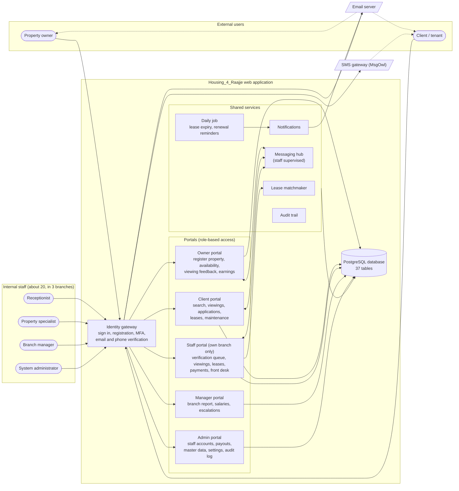
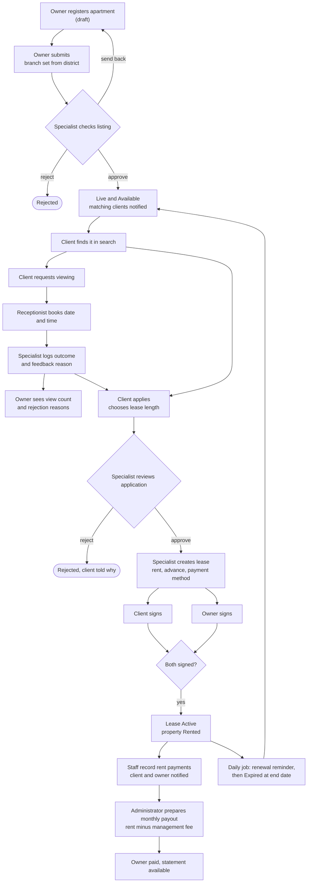

# Conceptual diagram

## 1. Actors, system components and interactions

Six kinds of user reach the system through four portals. Every portal talks to the same application and the same database.
What a user can see is decided by their role and, for staff, by their branch.

| Component | What it does |
|---|---|
| Identity gateway | One sign-in for everyone. Owners and clients register themselves; staff are invited by the administrator. Administrators and managers must enter an emailed code; others may switch that on. |
| Owner portal | Apartment Registration Form, availability switch, viewing statistics and rejection reasons, earnings and statements. |
| Client portal | Property search, viewing requests, rental applications, lease signing, payment history, maintenance requests. |
| Staff portal | The work of one branch: checking listings and applications, booking and logging viewings, executing leases, recording payments, front-desk inquiries. |
| Manager portal | Branch occupancy and income report, staff activity and salaries, resolving escalated disputes. |
| Admin portal | Staff accounts, owner payouts, master data, global settings, audit log. |
| Lease matchmaker | Compares a newly approved listing with each client's maximum rent, preferred area and room count, and tells the clients who fit. |
| Messaging hub | Conversations about a property between client and owner, visible to that branch's staff. |
| Notifications | In-app and email alerts for decisions, signatures, payments, maintenance and renewals. |
| Audit trail | Append-only log of approvals, leases, payments, payouts and settings changes. |
| Daily job | Marks finished leases as expired, frees the property, and sends renewal reminders. |

## 2. The rental process

How one apartment moves from registration to monthly payouts, and who acts at each step.

## 3. Who can do what

| Action | Owner | Client | Receptionist | Specialist | Manager | Admin |
|---|:-:|:-:|:-:|:-:|:-:|:-:|
| Register and edit own properties | ✓ | | | | | |
| Search properties, request viewings, apply | | ✓ | | | | |
| Sign a lease they are party to | ✓ | ✓ | | | | |
| Report maintenance, send messages | ✓ | ✓ | | | | |
| See branch properties, viewings, leases | | | ✓ | ✓ | ✓ | |
| Book viewings, log inquiries, update contacts, record payments | | | ✓ | ✓ | ✓ | |
| Approve listings and applications, log viewing feedback, create and end leases | | | | ✓ | ✓ | |
| Branch report, staff salaries, resolve escalations | | | | | ✓ | |
| Staff accounts, payouts, master data, settings, audit log | | | | | | ✓ |

Staff rows apply to the staff member's own branch only.
