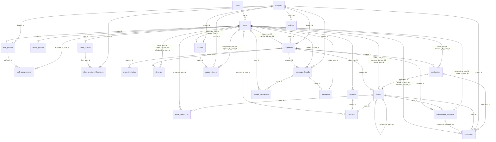

# Relational schema

Generated from the same database as the [data dictionary](02-data-dictionary.md). 37 tables, 68 foreign keys.

## Entity relationship diagram

Each line reads "one parent has many children". Labels are the foreign key columns. The lookup tables and login helper tables are left out of the picture to keep it readable; they are in the notation below.

## Relational notation

`table(columns)`. **Bold** = primary key. *Italic* = foreign key, with the table it points to. Timestamps (`created_at`, `updated_at`) are left out.

### Reference data

- **branches**(**id**, branch_no, code, name, phone, is_active)
- **districts**(**id**, name, *branch_id* → branches, is_active)
- **lease_terms**(**id**, months, label, is_active)
- **payment_methods**(**id**, code, name, is_active)
- **feedback_categories**(**id**, label, is_rejection, sort_order, is_active)
- **system_parameters**(**id**, key, value, description, *updated_by_user_id* → users)

### People and access

- **roles**(**id**, code, name)
- **permissions**(**id**, code, description)
- **permission_role**(***permission_id* → permissions**, ***role_id* → roles**)
- **users**(**id**, *role_id* → roles, name, email, email_verified_at, phone, phone_verified_at, password, is_active, last_login_at, remember_token, mfa_enabled)
- **staff_profiles**(***user_id* → users**, staff_code, *branch_id* → branches, job_title, hired_on)
- **staff_compensation**(**id**, *staff_user_id* → staff_profiles, monthly_salary, effective_from, effective_to, *recorded_by_user_id* → users)
- **owner_profiles**(***user_id* → users**, national_id_or_passport, bank_name, bank_account_name, bank_account_no)
- **client_profiles**(***user_id* → users**, national_id_or_passport, sex, date_of_birth, max_monthly_rent, preferred_rooms, preferred_term_months)
- **client_preferred_branches**(***client_user_id* → client_profiles**, ***branch_id* → branches**)
- **password_reset_tokens**(**email**, token, created_at)
- **staff_invite_tokens**(**email**, token, created_at)
- **one_time_codes**(**id**, *user_id* → users, purpose, channel, code_hash, attempts, expires_at, consumed_at)
- **trusted_devices**(**id**, *user_id* → users, token_hash, user_agent, last_used_at, expires_at)
- **sessions**(**id**, user_id, ip_address, user_agent, payload, last_activity)

### Properties

- **properties**(**id**, reference, *owner_user_id* → users, *district_id* → districts, *branch_id* → branches, house_name, road, unit_no, floor, property_type, rooms, monthly_rent, verification_status, availability_status, submitted_at, *verified_by_user_id* → users, verified_at)
- **property_photos**(**id**, *property_id* → properties, file_path, sort_order)

### Viewings and applications

- **viewings**(**id**, *property_id* → properties, *client_user_id* → users, status, requested_at, scheduled_for, *scheduled_by_user_id* → users, *feedback_category_id* → feedback_categories, staff_note, *logged_by_user_id* → users, logged_at)
- **applications**(**id**, reference, *property_id* → properties, *client_user_id* → users, *lease_term_id* → lease_terms, requested_start_date, occupants, employer, income_bracket, status, submitted_at, reviewed_at, *reviewed_by_user_id* → users, decision_note)

### Leases and money

- **leases**(**id**, reference, *application_id* → applications, *renewal_of_lease_id* → leases, *property_id* → properties, *client_user_id* → users, *owner_user_id* → users, *executed_by_user_id* → users, executed_at, activated_at, terminated_at, status, start_date, term_months, end_date, monthly_rent, advance_amount, *payment_method_id* → payment_methods, termination_reason)
- **lease_signatures**(***lease_id* → leases**, **party**, *signed_by_user_id* → users, signed_at, verification_method, ip_address, created_at)
- **payments**(**id**, reference, *lease_id* → leases, kind, period_month, amount, *payment_method_id* → payment_methods, bank_reference, received_on, *recorded_by_user_id* → users, *payout_id* → payouts)
- **payouts**(**id**, *owner_user_id* → users, period_month, gross_amount, fee_amount, net_amount, fee_percent, status, paid_at, bank_reference)

### Support

- **maintenance_requests**(**id**, *property_id* → properties, *lease_id* → leases, *raised_by_user_id* → users, category, description, priority, status, *assigned_to_user_id* → users, resolved_at)
- **inquiries**(**id**, *branch_id* → branches, *logged_by_user_id* → users, channel, contact_name, contact_phone, *related_user_id* → users, subject, details, status)
- **support_tickets**(**id**, *inquiry_id* → inquiries, *branch_id* → branches, *opened_by_user_id* → users, *assigned_to_user_id* → users, subject, description, status, resolved_at)
- **escalations**(**id**, *branch_id* → branches, *raised_by_user_id* → users, *lease_id* → leases, *maintenance_request_id* → maintenance_requests, *application_id* → applications, reason, status, *resolved_by_user_id* → users, resolution, resolved_at)

### Communication

- **message_threads**(**id**, *branch_id* → branches, *property_id* → properties, subject, *created_by_user_id* → users)
- **thread_participants**(***thread_id* → message_threads**, ***user_id* → users**, last_read_at)
- **messages**(**id**, *thread_id* → message_threads, *sender_user_id* → users, body, created_at)
- **notifications**(**id**, type, notifiable_type, notifiable_id, data, read_at)

### System

- **audit_log**(**id**, *user_id* → users, action, table_name, record_id, old_values, new_values, ip_address, created_at)

## Foreign keys

| Child table | Column | Parent table | On delete |
|---|---|---|---|
| `districts` | `branch_id` | `branches.id` | restrict |
| `system_parameters` | `updated_by_user_id` | `users.id` | restrict |
| `permission_role` | `permission_id` | `permissions.id` | cascade |
| `permission_role` | `role_id` | `roles.id` | cascade |
| `users` | `role_id` | `roles.id` | restrict |
| `staff_profiles` | `branch_id` | `branches.id` | restrict |
| `staff_profiles` | `user_id` | `users.id` | restrict |
| `staff_compensation` | `recorded_by_user_id` | `users.id` | restrict |
| `staff_compensation` | `staff_user_id` | `staff_profiles.user_id` | restrict |
| `owner_profiles` | `user_id` | `users.id` | restrict |
| `client_profiles` | `user_id` | `users.id` | restrict |
| `client_preferred_branches` | `branch_id` | `branches.id` | cascade |
| `client_preferred_branches` | `client_user_id` | `client_profiles.user_id` | cascade |
| `one_time_codes` | `user_id` | `users.id` | cascade |
| `trusted_devices` | `user_id` | `users.id` | cascade |
| `properties` | `branch_id` | `branches.id` | restrict |
| `properties` | `district_id` | `districts.id` | restrict |
| `properties` | `owner_user_id` | `users.id` | restrict |
| `properties` | `verified_by_user_id` | `users.id` | restrict |
| `property_photos` | `property_id` | `properties.id` | cascade |
| `viewings` | `client_user_id` | `users.id` | restrict |
| `viewings` | `feedback_category_id` | `feedback_categories.id` | restrict |
| `viewings` | `logged_by_user_id` | `users.id` | restrict |
| `viewings` | `property_id` | `properties.id` | restrict |
| `viewings` | `scheduled_by_user_id` | `users.id` | restrict |
| `applications` | `client_user_id` | `users.id` | restrict |
| `applications` | `lease_term_id` | `lease_terms.id` | restrict |
| `applications` | `property_id` | `properties.id` | restrict |
| `applications` | `reviewed_by_user_id` | `users.id` | restrict |
| `leases` | `application_id` | `applications.id` | restrict |
| `leases` | `client_user_id` | `users.id` | restrict |
| `leases` | `executed_by_user_id` | `users.id` | restrict |
| `leases` | `owner_user_id` | `users.id` | restrict |
| `leases` | `payment_method_id` | `payment_methods.id` | restrict |
| `leases` | `property_id` | `properties.id` | restrict |
| `leases` | `renewal_of_lease_id` | `leases.id` | restrict |
| `lease_signatures` | `lease_id` | `leases.id` | restrict |
| `lease_signatures` | `signed_by_user_id` | `users.id` | restrict |
| `payments` | `lease_id` | `leases.id` | restrict |
| `payments` | `payment_method_id` | `payment_methods.id` | restrict |
| `payments` | `payout_id` | `payouts.id` | restrict |
| `payments` | `recorded_by_user_id` | `users.id` | restrict |
| `payouts` | `owner_user_id` | `users.id` | restrict |
| `maintenance_requests` | `assigned_to_user_id` | `users.id` | restrict |
| `maintenance_requests` | `lease_id` | `leases.id` | restrict |
| `maintenance_requests` | `property_id` | `properties.id` | restrict |
| `maintenance_requests` | `raised_by_user_id` | `users.id` | restrict |
| `inquiries` | `branch_id` | `branches.id` | restrict |
| `inquiries` | `logged_by_user_id` | `users.id` | restrict |
| `inquiries` | `related_user_id` | `users.id` | restrict |
| `support_tickets` | `assigned_to_user_id` | `users.id` | restrict |
| `support_tickets` | `branch_id` | `branches.id` | restrict |
| `support_tickets` | `inquiry_id` | `inquiries.id` | restrict |
| `support_tickets` | `opened_by_user_id` | `users.id` | restrict |
| `escalations` | `application_id` | `applications.id` | restrict |
| `escalations` | `branch_id` | `branches.id` | restrict |
| `escalations` | `lease_id` | `leases.id` | restrict |
| `escalations` | `maintenance_request_id` | `maintenance_requests.id` | restrict |
| `escalations` | `raised_by_user_id` | `users.id` | restrict |
| `escalations` | `resolved_by_user_id` | `users.id` | restrict |
| `message_threads` | `branch_id` | `branches.id` | restrict |
| `message_threads` | `created_by_user_id` | `users.id` | restrict |
| `message_threads` | `property_id` | `properties.id` | restrict |
| `thread_participants` | `thread_id` | `message_threads.id` | cascade |
| `thread_participants` | `user_id` | `users.id` | cascade |
| `messages` | `sender_user_id` | `users.id` | restrict |
| `messages` | `thread_id` | `message_threads.id` | restrict |
| `audit_log` | `user_id` | `users.id` | restrict |

"restrict" means a parent row cannot be deleted while children exist, which protects history (for example a user with leases). "cascade" is used only where the child has no meaning alone (photos of a property, participants of a conversation, a user's login codes).

## Rules the database enforces by itself

- **Generated references.** `properties.reference` (H4R-APT-0001), `applications.reference` (H4R-APP-), `leases.reference` (H4R-LSE-) and `payments.reference` (H4R-RCT-) are built from the id.
- **Lease end date.** `leases.end_date` = `start_date` + `term_months` − 1 day, calculated by the database.
- **One live lease per property.** A partial unique index allows only one lease in `pending_signature` or `active` per property.
- **One open application per client and property.** A partial unique index covers `draft`, `submitted` and `under_review`.
- **Approved means available.** A property has an availability status if and only if it is approved.
- **A lease has exactly one origin**: an application or the lease it renews. **An escalation has exactly one subject.**
- **Payout arithmetic.** `net_amount` must equal `gross_amount − fee_amount`.
- **Completed viewings need feedback**: a reason, the staff member and the time.
- **Emails are unique without regard to letter case.**
